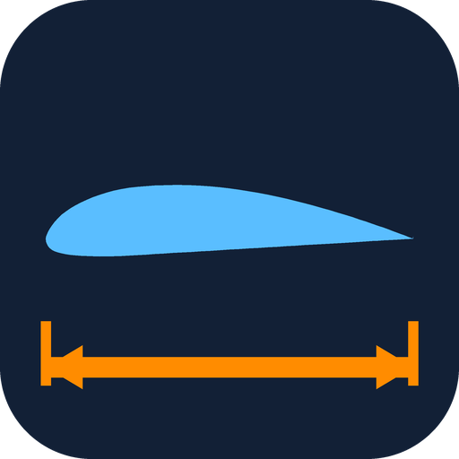

<p align="center"></p>

<h1 align="center">Parametric Airfoil by Syed Mujahid</h1>

<p align="center"><b>An Autodesk Fusion add-in that creates airfoil sketches you can resize at any time —<br>
just change the chord in <i>Change Parameters</i> and the whole wing updates.</b></p>

<p align="center">
  <a href="LICENSE"></a>
  
  
</p>

---

## The problem

I hit this while designing a VTOL UAV from scratch in Fusion. Existing airfoil add-ins (including Autodesk's own sample) all do the same thing: read a `.dat` file and draw a spline. That gives you a **dead shape**:

- **No parametric control.** The chord is baked into the spline. There is nothing to edit later.
- **It often won't extrude.** The spline's first and last points meet at a sharp trailing edge, the profile doesn't close cleanly, and Extrude/Loft fail.
- **It breaks late in the design.** Once ribs, spars, and lofts are built on the airfoil and the chord needs to change, you're stuck — re-importing breaks the timeline, and even the **Scale** feature fails on it.

## The solution

**Parametric Airfoil** builds the airfoil as a fully constrained, parameter-driven sketch:

- **Every spline point is dimensioned** with an expression of two user parameters — the chord (e.g. `RootChord`) and the trailing-edge thickness (`TE_Thk`).
- **Change the chord at any time** in **MODIFY → Change Parameters**, and the airfoil, and everything built on it, updates.
- **Always a closed profile.** A blunt trailing edge (default 1 mm, prints well) is closed with a line, so the profile always extrudes and lofts.
- The parameters appear automatically in the **Parameters** dialog.

## Features

| | |
|---|---|
| **3 airfoil sources** | Clark Y (wings), NACA 0009 (tails / symmetric), or **import any `.dat` file** (Selig or Lednicer format, e.g. from the [UIUC Airfoil Database](https://m-selig.ae.illinois.edu/ads/coord_database.html)) |
| **Any plane** | Pick an origin plane, construction plane, or planar face |
| **Shared parameters** | Reuse one parameter name across several sketches, or use new names (e.g. `RootChord`, `TipChord`, `TailChord`) for each section |
| **Accurate import** | Imported files are resampled with cosine spacing; a NACA 4412 import matches the exact shape to within 0.00005 × chord |
| **Cambered airfoils** | Works with high-lift sections whose lower surface rises above the chord line |
| **Resolution** | 15–61 spline points per surface (25 by default) |

## Install (free)

### Option A – from GitHub

1. Download this repository: **Code → Download ZIP**, and unzip it.
2. In Fusion, open **UTILITIES → ADD-INS → Scripts and Add-Ins** (or press **Shift + S**).
3. Click **+** (*Script or add-in from my computer*) and select the **`ParametricAirfoil`** folder (the one containing `ParametricAirfoil.manifest`).
4. Select **Parametric Airfoil** in the list, click **Run**, and turn on **Run on Startup**.

### Option B – Autodesk App Store

*Coming soon* — once approved it will be installable directly from the Autodesk App Store.

## How to use

1. In the **DESIGN** workspace, click **SOLID → CREATE → Parametric Airfoil** (the airfoil icon on the toolbar).
2. Choose the **Airfoil**: `Clark Y`, `NACA 0009`, or `Import .dat file...`.
3. Select the **Plane** to draw on (XY is selected by default). The leading edge sits on the sketch origin and the chord runs along the sketch +X axis. With **Look at airfoil** on, the view turns to face the new airfoil.
4. Set the **Chord parameter** name and **Chord length** (e.g. `RootChord` = 280 mm).
5. Set the **Trailing-edge thickness** (≥ 0.5 mm recommended; 1 mm prints well).
6. Click **OK**. Extrude or loft the profile as usual.
7. To resize later: **MODIFY → Change Parameters**, then edit `RootChord`.

**Tip — tapered wing:** create the root airfoil on one plane with `RootChord`, and the tip on an offset plane with `TipChord`, then **Loft** between them. Both chords stay editable.

## How it works

Each airfoil is reduced to cosine-spaced stations along the chord. The spline runs upper trailing edge → leading edge → lower trailing edge, and each fit point gets two driving dimensions:

- **horizontal** from the origin: `RootChord * x`
- **vertical** from a reference point one chord below the origin: `RootChord * (1 + y) ± TE_Thk * x/2`

Measuring vertically from a point below the airfoil keeps every dimension positive, so cambered profiles never produce zero-length or flipped dimensions. The leading edge is coincident with the sketch origin, and a line closes the blunt trailing edge, so the result is one closed, fully constrained profile.

The geometry code in [`airfoil_core.py`](ParametricAirfoil/airfoil_core.py) is plain Python and can be tested without Fusion:

```bash
python tests/test_airfoil_core.py
```

## Example files

[`examples/`](examples/) contains a NACA 2412 (Selig format) and a NACA 4412 (Lednicer format), generated from the NACA equations, for testing the import option.

## Roadmap

- More built-in airfoils (NACA 4-digit generator, popular RC and UAV sections)
- Washout / twist parameter
- Sketch on the active component

Ideas and pull requests are welcome — open an [issue](../../issues).

## Author

**Syed Mujahid** — built while designing a VTOL UAV from scratch.
GitHub: [@syedmujahid7040](https://github.com/syedmujahid7040)

## License

[MIT](LICENSE) © 2026 Syed Mujahid
